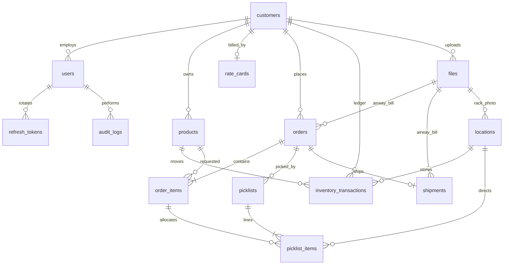

# Data model

`inventory_balances` and `inventory_balances_by_sku` are views, not tables. They sum `inventory_transactions`.

## Tables

| Table | Purpose |
| --- | --- |
| customers | Tenant |
| users | People. Role is admin, warehouse_supervisor, picker, packer, or customer |
| refresh_tokens | Rotating refresh sessions, hash only |
| products | SKU per customer, globally unique barcode, dimensions, reorder point |
| locations | `location_code` zone-rack-level, plus an optional rack photo |
| inventory_transactions | Append-only ledger |
| orders / order_items | Outbound orders. `picked_qty` and `packed_qty` are progress, not stock |
| picklists / picklist_items | Route-sorted allocation |
| shipments | Created at pack confirmation, stock reduced at dispatch |
| files | Object metadata for MinIO or local storage |
| audit_logs | User, action, timestamp, IP, old value, new value |
| document_sequences | Daily document numbers |
| rate_cards | Storage, inbound, and pick-pack fees |
| idempotency_keys | Reserved for clients that want a dedicated key table. Order create uses `orders.idempotency_key` |

## Order states

`PENDING` → `PICKING` → `PICKED` → `PACKING` → `READY_TO_SHIP` → `SHIPPED`

`CANCELLED` is allowed until the order ships. Cancellation releases the reservation and does not post an outbound.

## Views

`inventory_balances` groups by customer, product, and location. Reservation rows have a null location, so available stock for a SKU is read from `inventory_balances_by_sku`.
